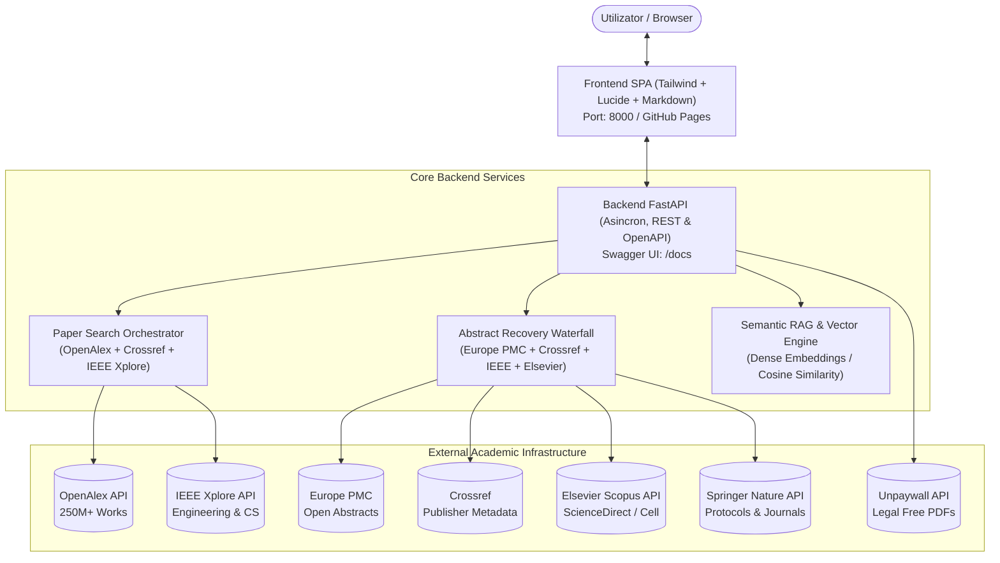

# 🎓 ScholarAgent v3.0 — Semantic Search & RAG on Academic Abstracts

**ScholarAgent** este o platformă modernă, modularizată (Backend FastAPI + Frontend Responsive + Docker) dedicată cercetării academice de înaltă precizie. Aplicația oferă căutare semantică vectorială peste abstracte, recuperare automată a abstractelor pentru lucrări cu barieră de plată (**IEEE Xplore, Elsevier ScienceDirect, Springer Nature**), verificare a accesului liber prin **Unpaywall** și un motor interactiv de **RAG (Retrieval-Augmented Generation)** pe abstracte.

---

## 🏛️ Arhitectura Sistemului



---

## ✨ Funcționalități Principale

### 1. Căutare Semantică & Reordonare Vectorială
* Spre deosebire de motoarele tradiționale ce caută doar potriviri exacte de cuvinte cheie, ScholarAgent vectorizează abstractele și calculează **similitudinea cosinus** față de intenția de cercetare a utilizatorului.
* Fiecare lucrare primește un indicator vizual: **Scor Relevanță Semantică (%)**.

### 2. RAG pe Abstracte (Question-Answering Interactiv)
* Poți pune întrebări specifice corpusului de lucrări găsite (ex: *„Ce benchmark-uri au fost folosite?”*, *„Care sunt limitările metodologiilor?”*).
* Motorul selectează cele mai relevante fragmente din abstracte (Top-K Vector Retrieval) și generează un răspuns fundamentat pe evidențe, cu **citări interactive `[1]`, `[2]`** ce evidențiază direct cardul lucrării.

### 3. Integrare IEEE Xplore, Elsevier & Marii Publisheri
* **IEEE Xplore REST API:** Căutare dedicată și recuperare oficială de abstracte pentru reviste și conferințe IEEE (DOI `10.1109/...`).
* **Elsevier ScienceDirect / Scopus API:** Extragere oficială de abstracte pentru publicații din Cell, Lancet sau reviste Elsevier (DOI `10.1016/...`).
* **Springer Nature API:** Interogare metadate și abstracte din portofoliul Springer.

### 4. Cascade de Recuperare Automată (Waterfall) pentru Paperuri Paywalled
Pentru orice articol unde abstractul lipsește din indexul inițial, backend-ul rulează automat o cascadă de interogare în background:
1. **Europe PMC REST API** (index deschis, milioane de abstracte disponibile public).
2. **Crossref REST API** (extragere din depuneri oficiale JATS XML ale editurilor).
3. **IEEE Xplore REST API** (dacă există cheie IEEE).
4. **Elsevier Scopus API** (dacă există cheie Elsevier).
5. **Semantic Scholar Academic Graph API**.

### 5. Detectare Open Access & Verificare Unpaywall Live
* Identifică instant dacă un articol poate fi descărcat gratuit (arXiv, PubMed Central, repository universitar).
* Pentru articolele paywalled, verifică dacă autorul a publicat un preprint/postprint legal prin **Unpaywall**.
* Permite configurarea unui **Proxy Instituțional (EZProxy)** pentru deschiderea articolelor prin abonamentul de la muncă.

---

## 📂 Structura Repository-ului

```text
scholar-agent/
├── backend/                  # Backend FastAPI & RAG Engine
│   ├── app/
│   │   ├── __init__.py
│   │   ├── main.py          # Punctul de intrare FastAPI & Rute API
│   │   ├── config.py        # Setări & variabile de mediu
│   │   ├── models/
│   │   │   └── schemas.py   # Modele Pydantic (Paper, SearchRequest, RAG)
│   │   └── services/
│   │       ├── paper_service.py      # Agregator OpenAlex, IEEE, Crossref
│   │       ├── abstract_waterfall.py # Recuperare automată abstracte paywalled
│   │       └── semantic_rag.py       # Vector embeddings & RAG Question Answering
│   ├── requirements.txt     # Dependențe Python (FastAPI, uvicorn, scikit-learn, httpx)
│   └── Dockerfile           # Imagine Docker containerizată Python 3.11
├── frontend/                 # Interfața SPA (Vanilla JS + Tailwind + Lucide)
│   ├── index.html           # Structură HTML & Drawer RAG QA
│   ├── app.js               # Conexiune Backend & Fallback Client-side
│   └── styles.css           # Stiluri personalizate, carduri și animații
├── docker-compose.yml        # Orchetrare container Docker
├── .dockerignore
├── .gitignore
├── .nojekyll
├── index.html                # Punct de intrare pentru GitHub Pages
├── app.js
├── styles.css
└── README.md                 # Documentație completă
```

---

## 🚀 Cum rulezi proiectul

### Opțiunea 1: Cu Docker Compose (Cea mai recomandată)

Totul este gata configurat (FastAPI + Servire Frontend + Vector Embeddings). Rulează o singură comandă:

```bash
docker compose up --build
```

Aplicația va fi accesibilă la:
* **Interfață Web:** [http://localhost:8000](http://localhost:8000)
* **Documentație Interactivă Swagger:** [http://localhost:8000/docs](http://localhost:8000/docs)
* **ReDoc:** [http://localhost:8000/redoc](http://localhost:8000/redoc)

---

### Opțiunea 2: Rulare Locală cu Python (Fără Docker)

Dacă vrei să rulezi backend-ul direct în Python:

```bash
# 1. Intră în folderul backend
cd backend

# 2. Creează un mediu virtual (opțional, dar recomandat)
python3 -m venv venv
source venv/bin/activate   # Pe Windows: venv\Scripts\activate

# 3. Instalează dependențele
pip install -r requirements.txt

# 4. Pornește serverul FastAPI
uvicorn app.main:app --reload --host 0.0.0.0 --port 8000
```

Deschide [http://localhost:8000](http://localhost:8000) în browser.

---

### Opțiunea 3: Live pe GitHub Pages (Fără instalare)

Aplicația este publicată și direct pe GitHub Pages:
👉 **[https://robertvatasoiu.github.io/scholar-agent/](https://robertvatasoiu.github.io/scholar-agent/)**

*Pe GitHub Pages, dacă nu ai un backend local pornit, aplicația intră automat în modul „Client Direct”, folosind API-urile publice OpenAlex, Crossref și Europe PMC direct din browser.*

---

## ⚙️ Configurare & Chei API (Opționale)

Poți crea un fișier `.env` în rădăcina proiectului sau poți adăuga cheile direct în interfață din meniul **Setări & API**:

| Variabilă de Mediu | Descriere | Necesară? | Unde o obții? |
| :--- | :--- | :--- | :--- |
| `IEEE_API_KEY` | Căutare directă & abstracte IEEE Xplore | Opțional | [developer.ieee.org](https://developer.ieee.org/) |
| `ELSEVIER_API_KEY` | Abstracte oficiale din ScienceDirect / Scopus | Opțional | [dev.elsevier.com](https://dev.elsevier.com/) |
| `GEMINI_API_KEY` | Sinteză narativă generativă pentru RAG | Opțional | [Google AI Studio](https://aistudio.google.com/) |
| `POLITE_EMAIL` | Email pentru prioritate pe OpenAlex & Unpaywall | Recomandat | Email-ul tău |

---

## 📡 Endpoints API Backend

| Metodă | Endpoint | Descriere |
| :--- | :--- | :--- |
| `GET` | `/api/health` | Status serviciu și verificare disponibilitate motor embeddings. |
| `POST` | `/api/search` | Căutare multi-sursă (IEEE, OpenAlex, Crossref) + reordonare semantică. |
| `POST` | `/api/rag/ask` | Interogare RAG pe abstractele găsite (extrage evidențe și citări). |
| `POST` | `/api/abstract/recover` | Declanșează manual cascada de recuperare a abstractului pentru un DOI. |
| `GET` | `/docs` | Interfața Swagger UI interactivă pentru testarea tuturor rutelor. |

---

## 📄 Licență
Construit pentru cercetare academică deschisă și acces eficient la literatura științifică.
